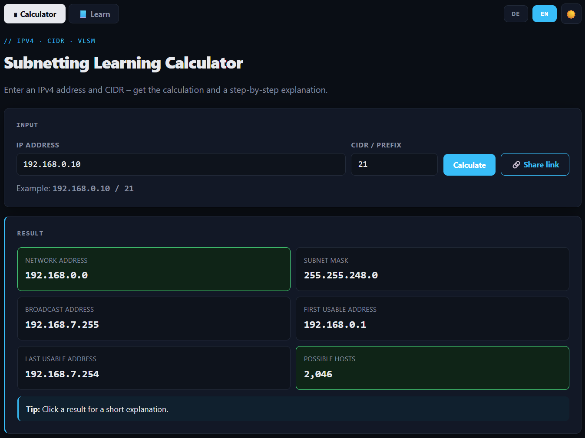
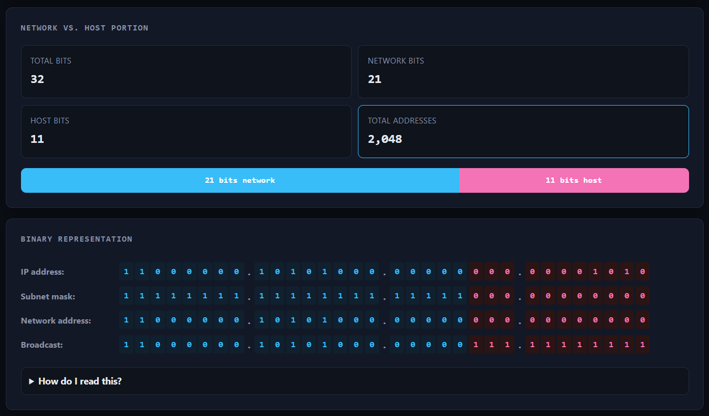
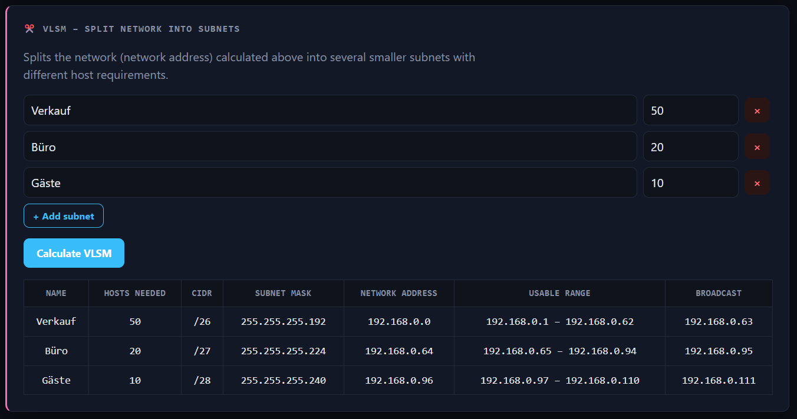
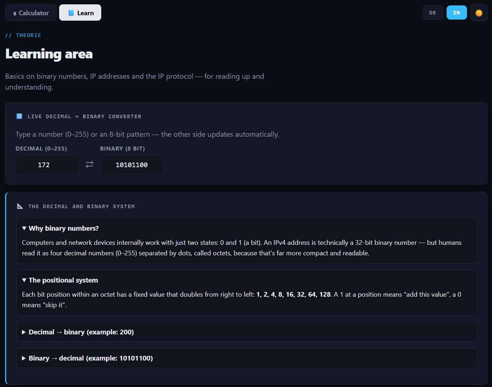

\# Subnetting Learning Calculator

A browser-based IPv4 subnetting calculator and learning tool created to support my retraining as an IT specialist in system integration (Fachinformatiker für Systemintegration).

\## Features

\- IPv4 and CIDR calculations

\- Network and broadcast address calculation

\- Subnet masks and usable host ranges

\- Binary visualization

\- VLSM subnet planning

\- Reverse subnet calculator

\- Interactive subnetting quiz

\- Networking learning section

\- Decimal-to-binary converter

\- German and English interface

\- Light and dark mode

\## Technologies

\- HTML5

\- CSS

\- JavaScript

\- Git and GitHub

\- GitHub Actions

\- SSH and SCP

\- Linux server

\## Local Usage

Clone the repository or download `index.html`.

Open `index.html` in a web browser.

No backend, database or additional dependencies are required.

\## Deployment

The application was previously hosted on a rented Linux server.

A GitHub Actions workflow automated the deployment process:

1\. Trigger the workflow after a push to the main branch.

2\. Check out the repository.

3\. Back up the existing HTML file on the remote server using SSH.

4\. Upload the updated HTML file using SCP.

Server credentials are managed using GitHub Actions Secrets.

The deployment workflow is currently disabled.

\## Development Approach

This project was created with AI-assisted development.

I defined the requirements, selected the features, tested the application, and worked on troubleshooting and improvements. AI was used to assist with code generation and deployment configuration.

The project serves as a practical learning exercise in networking, version control, server administration and deployment automation.

\## Project Status

The application is functional and has been tested manually.

Public web hosting is currently disabled.

## Screenshots

### Subnet Calculator

### Binary Visualization

### VLSM Calculator

### Learning Area

